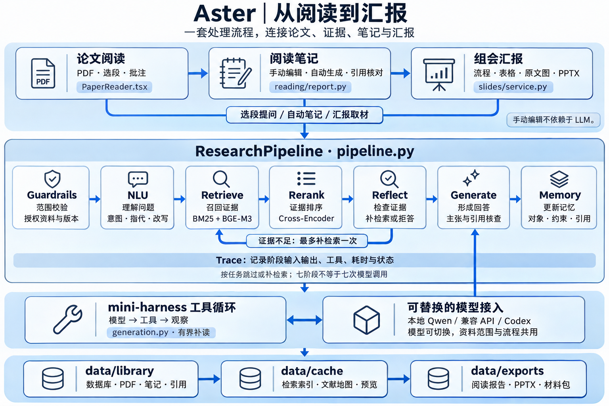

# Aster

面向科研文献阅读，整合 PDF 批注、检索增强问答、手动／自动笔记与 PPT 生成，打通论文阅读、知识整理和组会汇报流程。

[快速启动](#快速启动) · [技术方案与代码学习](#技术方案与代码学习) · [Web 使用指南](docs/WEB_GUIDE.md) · [实验指南](docs/EXPERIMENTS.md)

## 功能

| 功能 | 支持内容 |
|---|---|
| 论文阅读 | 原始 PDF 连续滚动、选段提问、批注、阅读进度与版本引用 |
| 多轮问答 | 指代消解、按需检索、证据核查；支持本地 Qwen、兼容 API 和 Codex CLI |
| 阅读笔记 | 手动记录或自动精读，支持表格、公式、原文图版、引用与后续编辑 |
| PPT 汇报 | 从论文和笔记生成页面，编辑流程、表格、配图与讲稿，导出可编辑 PPTX |
| 文献地图 | 按主题浏览，联动相关论文与笔记；导入、修改和删除资料后更新 |

知识库可自定义研究方向。论文、笔记和汇报支持管理、回收站、版本记录与项目备份。

## 快速启动

需要 Python 3.12+、uv、Node.js 20+。在仓库根目录运行：

```sh
uv sync --extra retrieval
npm ci --prefix web
npm run build --prefix web
cp .env.example .env
# 配置 ASTER_MODEL_URL、ASTER_MODEL；已有 .env 时直接编辑
uv run aster
```

访问 `http://127.0.0.1:8765`，在“设置与模型”添加本地 Qwen 或其他模型。阅读和手动笔记无需模型；问答及自动生成需要可用模型服务。未配置向量模型时检索降级为 BM25。

```sh
uv run aster models --download
uv run aster collect --topic metabolomics --limit 30
uv run aster collect --topic ai4bio --limit 40
```

采集开放获取论文并导入原始 PDF，保留 DOI、期刊、来源与许可。新克隆的仓库不附带论文、数据库或密钥；数据默认保存在项目的 `data/`，已排除 Git 跟踪。

## 技术方案与代码学习



React 页面通过 FastAPI 提交任务，`RunManager` 固定材料版本、模型与工作方法，交给 `ResearchPipeline` 执行。Qwen 是模型，mini-harness 负责工具循环，RAG 为回答提供原文证据。

### 一次任务的处理过程

```text
Guardrails → NLU → Retrieve → Rerank → Reflect → Generate → Memory
范围检查     问题理解  证据召回     重排      检查证据    生成与核查    更新记忆
```

NLU 通过结构化输出完成意图识别、指代消解和 Query 改写，选择检索、使用选段或通用讨论。Reflect 最多补检索一次；生成阶段通过 mini-harness 有界补读，再核查主张与引用。阶段可跳过或重试，不等于每轮调用模型七次。

`mode` 决定输出回答、阅读笔记或汇报；`model_profile_id` 决定模型；`retrieval_policy` 决定是否搜索。三者独立配置，复用同一处理流程。手动编辑直接保存，不调用模型。

### 证据、笔记与汇报

- **检索：** 按段落分块，长段采用 1,400 字符窗口、200 字符重叠；BM25 与 BGE-M3 稠密向量召回，经 RRF 融合和 Cross-Encoder 重排。FAISS 使用 `IndexFlatIP` 精确检索。
- **引用：** `Source → SourceVersion → SourceSpan / SourceChunk` 保存原文位置；`Artifact → ArtifactVersion → EvidenceLink` 关联笔记、汇报与依据。部分论文分别保留结构化检索文本与原始 PDF。
- **笔记与 PPT：** 自动取材补充所选论文的章节内容，经核查后组装笔记或规划汇报；支持原图复用、人工修改和版本化保存。PPT 改写新增的事实另行核查，引用随讲稿导出。
- **状态与记忆：** AgentState 管理本轮执行；Turn／Stage Trace 记录阶段、工具、耗时与状态；Memory 跨轮保留对象、用户约束和引用。基础 harness 增加请求前上下文估算及摘要中的用户原话保留。
- **文献地图：** 根据标题与摘要／前两页构建 TF-IDF 相似关系，使用 Cytoscape.js 展示主题分组。资料与笔记变化后重算；连线表示文本相似。

模型核查仍需人工复核；原图提取不包含自动图表视觉分析。新论文会进入检索与地图，已有笔记和 PPT 保留原版本依据。

### 代码阅读顺序

| 顺序 | 入口 | 先理解什么 |
|---|---|---|
| 1 | [schemas.py](src/aster/domain/schemas.py)、[runtime.py](src/aster/app/runtime.py) | 一次请求如何固定资料、建立任务 |
| 2 | [pipeline.py](src/aster/agent/pipeline.py)、[planning.py](src/aster/agent/planning.py) | 七阶段如何衔接，何时检索、澄清或拒答 |
| 3 | [corpus.py](src/aster/retrieval/corpus.py)、[engine.py](src/aster/retrieval/engine.py)、[search.py](src/aster/agent/search.py) | 分块、混合检索、重排与补检索 |
| 4 | [generation.py](src/aster/agent/generation.py)、[report.py](src/aster/reading/report.py)、[slides/service.py](src/aster/slides/service.py) | 工具补读、引用核查与产物生成 |
| 5 | [trace.py](src/aster/agent/trace.py)、[memory.py](src/aster/agent/memory.py)、[mini_harness/agent.py](src/mini_harness/agent.py) | 执行追踪、跨轮记忆与上下文压缩 |

```text
web/src/features/    阅读、问答、笔记、汇报、地图
src/aster/app/       HTTP、配置、任务调度、CLI
src/aster/domain/    数据模型、文献与文档事务
src/aster/agent/     七阶段、生成核查、追踪、记忆
src/aster/retrieval/ 分块、索引、混合检索与重排
src/aster/library/   采集、文献地图、原图提取
src/aster/reading/   阅读取材与报告
src/aster/slides/    页面规划、复核、PPTX 导出
src/aster/models/    模型适配与凭据
src/aster/skills/    工作方法与自定义技能
src/aster/storage/   数据目录、迁移、备份
src/mini_harness/    通用工具循环与上下文管理
tests/ · eval/      工程回归与问答评测
bench/              SWE-bench 适配
```

建议练习：选段提问 → 点击引用 → 继续追问 → 生成并编辑笔记 → 制作汇报，再用 `uv run aster trace RUN_ID` 对照执行记录。新增模型放在 `models/`，新工作方法放在 `skills/`，通用工具循环改进放在 `mini_harness/`。

## 数据与评测

以下为维护者本机核对结果（2026-11-06），不代表仓库附带数据。分块按当前默认检索版本统计。

| 范围 | 论文 | 分块 |
|---|---:|---:|
| Metabolomics 日常库 | 330 | 21,599 |
| AI4Bio 日常库 | 40 | 3,083 |
| 历史问答评测快照 | 300 | 19,250 |

问答评测与产品共用七阶段流程；SWE-bench 检查通用编码 harness。历史成绩、题集规模和复现命令见 [实验指南](docs/EXPERIMENTS.md)，当前重构版本尚待完整复测。

## 简历摘要

**Aster：科研文献阅读与智能辅助平台**

面向科研文献阅读，整合 PDF 批注、检索增强问答、手动／自动笔记与 PPT 生成，打通论文阅读、知识整理和组会汇报流程。

- 基于 mini-harness 编排阅读问答、笔记与汇报任务，串联检索、证据核查、原图复用及产物保存，支持生成后编辑。
- 整理 330 篇代谢组学、40 篇 AI4Bio 论文，建立约 2.47 万个可追溯分块，实现混合召回、融合与重排。
- 扩展 Turn／Stage 追踪、会话记忆和上下文压缩；构建组件题集与 120-turn 多轮对话集，完成检索对照及小规模消融。

## 参考

底座：[mini-harness](https://github.com/mini-harness/mini-harness)。工作方法参考 [scientific-agent-skills](https://github.com/K-Dense-AI/scientific-agent-skills) 与 [codex-ppt-skill](https://github.com/ningzimu/codex-ppt-skill)；汇报流程参考 [Paper2Any](https://github.com/OpenDCAI/Paper2Any) 与 [Paper2Slides](https://github.com/HKUDS/Paper2Slides)。

工作方法作为指令适配，不自动执行上游脚本。原生 PPTX 由 Aster 导出；整页生图使用 Codex 材料包，需要外部 skill 与生图能力。架构图由生图模型绘制，展示模块职责。
